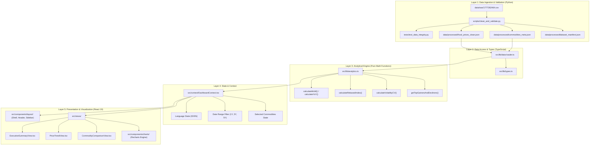

# PANGANOVA — Spesifikasi Arsitektur Teknis (Technical Architecture)

**Versi:** 1.0  
**Tanggal:** 4 November 2026  
**Status:** Baseline Arsitektur untuk Implementasi Frontend & Data  

---

## 1. Prinsip Arsitektur Utama

Platform PANGANOVA dibangun dengan standar arsitektur analitis tingkat tinggi:
1. **Pemisahan Tanggung Jawab Secara Ketat (Strict Separation of Concerns):**  
   Dilarang keras meletakkan perhitungan matematika, statistik perbandingan, atau transformasi data di dalam JSX/TSX komponen tampilan. Komponen antarmuka bersifat murni presentasional (*dumb/presentational components*), menerima data terhitung melalui props atau custom hooks.
2. **Deterministic & Reproducible Pipeline:**  
   Dataset mentah bersifat read-only. Seluruh proses transformasi data dari raw CSV ke format JSON bersih dikendalikan oleh skrip Python mandiri (`scripts/clean_and_validate.py`) yang dilengkapi automated unit testing.
3. **Design Identity Non-Generic (Anti AI Slop):**  
   UI mematuhi sistem token warna editorial hybrid (Warm Ivory `#F8F7F2`, Deep Forest Green `#123B32`, Emerald Green `#1E8063`, Harvest Gold `#E8B65A`, Charcoal `#202B29`) dengan tipografi presisi tabular.
4. **Bilingual Ready:**  
   Arsitektur mendukung pergantian bahasa antarmuka secara instan antara Bahasa Indonesia (ID) dan English (EN).

---

## 2. Diagram Aliran Data & Lapisan Sistem

---

## 3. Rincian Lapisan Arsitektur

### 3.1 Layer 1: Data Processing & Ingestion
- **Lokasi:** `scripts/clean_and_validate.py`
- **Tanggung Jawab:**
  - Membaca file CSV dari `data/raw/`.
  - Normalisasi whitespace nama komoditas.
  - Standardisasi tanggal ISO-8601 (`YYYY-MM-01`).
  - Parsing numerik harga, memetakan `"-"` menjadi `null`.
  - Validasi duplicate composite key `(commodity, date)`.
  - Menghasilkan file JSON di `data/processed/` dan laporan validasi di `data/processed/validation_report.md`.
- **Pengujian Otomatis:** `tests/test_data_integrity.py` dijalankan via `unittest` untuk menjamin integritas data sebelum build frontend.

### 3.2 Layer 2: Data Access Layer
- **Lokasi:** `src/lib/data-loader.ts` & `src/lib/types.ts`
- **Tanggung Jawab:**
  - Memuat file JSON bersih ke dalam memory client.
  - Menyediakan fungsi query typed:
    - `getAllCommodities(): CommodityMeta[]`
    - `getCommodityHistory(commodityId: string): PriceRecord[]`
    - `getObservationsByDateRange(startDate: string, endDate: string): PriceRecord[]`
    - `getObservationsForCommodities(commodityIds: string[], startDate: string, endDate: string): Map<string, PriceRecord[]>`

### 3.3 Layer 3: Analytical & Mathematical Engine
- **Lokasi:** `src/lib/analytics.ts`
- **Tanggung Jawab:**
  - Menyimpan pure functions tanpa side-effects untuk kalkulasi ekonomi:
    - `calculatePercentageChange(pInitial: number | null, pFinal: number | null): number | null`
    - `calculateAbsoluteChange(pInitial: number | null, pFinal: number | null): number | null`
    - `calculateRebasedIndex(records: PriceRecord[], baseDate: string): IndexedPriceRecord[]`
    - `calculateCoefficientOfVariation(prices: (number | null)[]): number | null`
    - `rankCommoditiesByChange(recordsMap: Map<string, PriceRecord[]>, t0: string, t1: string, direction: 'gainers' | 'decliners', limit: number): RankedCommodity[]`

### 3.4 Layer 4: Formatting & Localization Layer
- **Lokasi:** `src/lib/formatters.ts` & `src/i18n/`
- **Tanggung Jawab:**
  - Format angka mata uang Rupiah: `formatRupiah(val: number | null): string` $\to$ `"Rp 12.319"` atau `"-"`.
  - Format persentase: `formatPercent(val: number | null): string` $\to$ `"+4,25%"` atau `"-1,10%"`.
  - Format tanggal lokal (Indonesia & English): `formatDateLabel(dateStr: string, lang: 'id' | 'en'): string`.
  - Kamus dwibahasa `id.json` dan `en.json` untuk label UI, tooltip, dan pesan disclaimer.

### 3.5 Layer 5: UI & Presentation Components
- **Lokasi:** `src/components/` & `src/views/`
- **Tanggung Jawab:**
  - Render antarmuka yang clean, kontras tinggi, dan responsif.
  - Menampilkan visualisasi Recharts yang dikustomisasi dengan token desain PANGANOVA.
  - Menangani error boundaries, loading skeletons, dan empty state saat filter tidak menghasilkan data.

---

## 4. Spesifikasi & Justifikasi Technology Stack

| Teknologi | Versi Target | Alasan & Justifikasi Pemilihan |
| :--- | :--- | :--- |
| **React** | 19.x | Runtime komponen modern, optimalisasi rendering otomatis, dan arsitektur hook reaktif. |
| **Vite** | 6.x | Build tool tercepat untuk ekosistem React, Hot Module Replacement (HMR) instan, dan konfigurasi bundle statis yang efisien. |
| **TypeScript** | 5.x | Menjamin validasi tipe statis ketat; membedakan `number` dan `null` secara eksplisit pada compile-time agar tidak terjadi runtime error `NaN` atau `Cannot read properties of undefined`. |
| **Tailwind CSS** | 4.x / 3.4 | Atomic CSS engine untuk menerapkan token desain PANGANOVA tanpa mengandalkan library UI opiniated pihak ketiga (menjamin orisinalitas desain visual). |
| **Recharts** | 2.15+ | Pustaka charting deklaratif berbasis React dan SVG. Sangat fleksibel untuk styling custom tooltip, multi-line series, reference line, dan responsif terhadap perubahan tema. |
| **Lucide React** | Latest | Set ikon analitis konsisten, ringan (tree-shakeable), dan memiliki stroke elegan 1.5–1.75px. |
| **npm** | 11.x | Package manager resmi yang telah terpasang di sistem pengguna. |

*Daftar dependensi di atas bersifat final dan minimalis. Tidak ada library UI berat (MUI, AntD, Chakra) atau AI components generator pihak ketiga.*

---

## 5. Strategi Pengujian (Testing Strategy)

1. **Unit Testing Data Integrity (Python):**
   - File: `tests/test_data_integrity.py`
   - Memastikan tidak ada data mentah yang diubah, tidak ada baris yang hilang, duplicate key bernilai nol, dan nilai missing berstatus `null`.
2. **Unit Testing Logika Matematika Analitis (TypeScript):**
   - Menguji kebenaran rumus $\Delta\%$, Indeks Basis 100, dan Koefisien Variasi ($CV$) dengan berbagai kasus uji (misal: harga naik, harga turun, harga awal `null`, harga pembagi nol).
3. **Build & Typecheck Validation:**
   - Script `npm run build` yang mencakup `tsc --noEmit` untuk memastikan 100% type-safety sebelum artefak didistribusikan.

